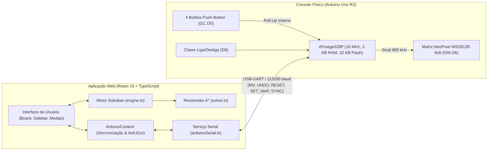
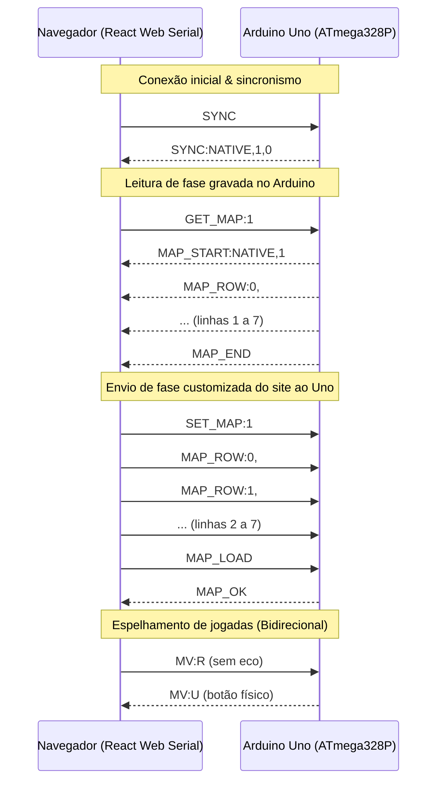

# SokoDay – Sokoban Web & Hardware Console (Arduino Uno 8×8)

Projeto integrado de **Sokoban** composto por uma **aplicação web moderna (React 19 + TypeScript + Vite)** e um **console físico com Arduino Uno (ATmega328P)** conectado a uma **matriz de LEDs endereçáveis WS2812B (NeoPixel) de 8×8**, 4 botões direcionais e chave liga/desliga.

O projeto permite jogar localmente no navegador, calcular soluções ótimas com inteligência artificial (**algoritmo A\***), espelhar a partida em tempo real no hardware via **Web Serial API** ou rodar o jogo de forma 100% autônoma (*standalone/offline*) diretamente no microcontrolador.

---

## Sumário

- [1. Visão Geral da Arquitetura](#1-visão-geral-da-arquitetura)
- [2. O Console Físico (Hardware & Arduino)](#2-o-console-físico-hardware--arduino)
  - [2.1. Componentes e Pinagem](#21-componentes-e-pinagem)
  - [2.2. Esquema de Cores na Matriz de LEDs](#22-esquema-de-cores-na-matriz-de-leds)
  - [2.3. Controles Físicos e Atalhos de Hardware](#23-controles-físicos-e-atalhos-de-hardware)
  - [2.4. Os Dois Firmwares Arduino (`arduino/`)](#24-os-dois-firmwares-arduino-arduino)
- [3. Protocolo Serial Bidirecional (Web Serial API)](#3-protocolo-serial-bidirecional-web-serial-api)
  - [3.1. Especificação do Protocolo](#31-especificação-do-protocolo)
  - [3.2. Comandos PC → Arduino](#32-comandos-pc--arduino)
  - [3.3. Mensagens Arduino → PC](#33-mensagens-arduino--pc)
  - [3.4. Mecanismo de Anti-Eco e Sincronização](#34-mecanismo-de-anti-eco-e-sincronização)
- [4. A Aplicação Web (Frontend)](#4-a-aplicação-web-frontend)
  - [4.1. Tecnologias Utilizadas](#41-tecnologias-utilizadas)
  - [4.2. Estrutura de Diretórios](#42-estrutura-de-diretórios)
  - [4.3. Motor de Jogo e Algoritmo de Resolução A*](#43-motor-de-jogo-e-algoritmo-de-resolução-a)
  - [4.4. Funcionalidades da Interface](#44-funcionalidades-da-interface)
- [5. Como Instalar e Rodar](#5-como-instalar-e-rodar)
  - [5.1. Executando o Frontend](#51-executando-o-frontend)
  - [5.2. Gravando o Firmware no Arduino Uno](#52-gravando-o-firmware-no-arduino-uno)
  - [5.3. Testes Rápidos e Validação Serial](#53-testes-rápidos-e-validação-serial)
- [6. Testes Automatizados](#6-testes-automatizados)

---

## 1. Visão Geral da Arquitetura

O sistema conecta o navegador ao microcontrolador através da **Web Serial API** em taxa de transmissão de **115200 baud**:



---

## 2. O Console Físico (Hardware & Arduino)

### 2.1. Componentes e Pinagem

| Componente | Pino Arduino Uno | Modo do Pino | Descrição / Comportamento |
|---|---|---|---|
| **Botão DIREITA** | `D2` | `INPUT_PULLUP` | Pressionado = `LOW` (GND) |
| **Botão ESQUERDA** | `D3` | `INPUT_PULLUP` | Pressionado = `LOW` (GND) |
| **Botão BAIXO** | `D4` | `INPUT_PULLUP` | Pressionado = `LOW` (GND) |
| **Botão CIMA** | `D5` | `INPUT_PULLUP` | Pressionado = `LOW` (GND) |
| **Matriz WS2812B (DIN)** | `D6` | `OUTPUT` | Linha de dados para os 64 LEDs RGB (800 kHz) |
| **Chave Geral de Energia** | `D9` | `INPUT` | `HIGH` = Jogo Ativo / `LOW` = Sistema Pausado e LEDs Apagados |
| **Alimentação** | `5V` e `GND` | Alimentação | 5V regulado (via USB ou fonte externa 5V 1A compartilhando GND) |

> [!TIP]
> O brilho padrão da matriz no firmware é mantido em **25** (cerca de 10% do brilho máximo de 255), limitando a corrente de pico abaixo de 300 mA para permitir alimentação direta e segura via porta USB do computador.

### 2.2. Esquema de Cores na Matriz de LEDs

Cada entidade clássica do Sokoban possui representação de cor dedicada na matriz 8×8:

| Entidade | Símbolo Clássico | Cor Visual | Código RGB | Comportamento |
|---|:---:|---|---|---|
| **Parede** | `#` | Azul Escuro / Acinzentado | `(25, 38, 60)` | Obstáculos intransponíveis |
| **Destino (Goal)** | `.` | Verde Esmeralda | `(0, 85, 0)` | Posição onde a caixa deve ser empurrada |
| **Caixa (Box)** | `$` | Marrom Âmbar | `(120, 53, 15)` | Caixa empurrável |
| **Caixa no Destino** | `*` | Ciano / Azul Claro | `(0, 170, 170)` | Caixa posicionada com sucesso |
| **Chão Vazio** | ` ` | Apagado | `(0, 0, 0)` | Célula caminhável |
| **Jogador** | `@` | Vermelho Pulsante | `(80..255, 0, 0)` | Efeito visual senoidal continuo |
| **Jogador no Destino** | `+` | Amarelo Pulsante | `(80..255, 80..255, 0)` | Jogador pisando sobre um destino |
| **Vitória** | — | Efeito Arco-Íris (*Rainbow*) | HSV dinâmico | Animação dinâmica celebrando a vitória |

### 2.3. Controles Físicos e Atalhos de Hardware

- **Passo Único:** Clique rápido em qualquer direção (Cima, Baixo, Esquerda ou Direita) move o personagem 1 casa e envia o movimento `MV:<dir>` pela Serial.
- **Desfazer (Undo):** Pressionar **CIMA + BAIXO** juntos por **1 segundo** desfaz a última jogada tanto na matriz quanto no site (`CMD:UNDO`). O histórico comporta até **80 passos** armazenados de forma comprimida (1 nibble por movimento) na SRAM do ATmega328P.
- **Reiniciar (Reset):** Manter **CIMA** pressionado por **3 segundos** recarrega a fase do zero (`CMD:RESET`).
- **Chave de Energia (D9):** Ao desligar, a matriz é imediatamente apagada (`strip.clear()`). Ao religar, o jogo recarrega a fase ativa.

---

### 2.4. Os Dois Firmwares Arduino (`arduino/`)

O repositório disponibiliza duas soluções completas de firmware dentro da pasta [`arduino/`](arduino/):

#### A) Modo Integrado com Site: [`arduino/uno-controller-website/`](arduino/uno-controller-website/)
- **Arquivo principal:** [`uno-controller-website.ino`](arduino/uno-controller-website/uno-controller-website.ino)
- **Documentação técnica:** [`README-ARDUINO.md`](arduino/uno-controller-website/README-ARDUINO.md)
- **Roteiro de validação:** [`TESTES_SERIAL.txt`](arduino/uno-controller-website/TESTES_SERIAL.txt)
- **Características:**
  - Loop principal 100% não bloqueante (orientado a temporizadores com `millis()`).
  - Suporte completo ao protocolo bidirecional: recebe fases enviadas pelo site via `SET_MAP` em área de *staging*, valida e salva em `customMap`.
  - Permite leitura das fases gravadas em Flash pelo navegador via `GET_MAP`.
  - Anti-eco nativo: movimentos recebidos via Serial não geram respostas em eco.
  - Pilha circular de Undo de 80 passos na RAM.
  - Interrupção de animações de vitória mediante chegada imediata de novos comandos do PC.

#### B) Modo Autônomo / Standalone: [`arduino/uno-controller-isolate/`](arduino/uno-controller-isolate/)
- **Arquivo principal:** [`uno-controller.ino`](arduino/uno-controller-isolate/uno-controller.ino)
- **Documentação técnica:** [`README-ARDUINO.md`](arduino/uno-controller-isolate/README-ARDUINO.md)
- **Características:**
  - Projetado para operar 100% desconectado de computadores (portátil, alimentado por bateria 9V ou carregador USB).
  - Contém 4 fases pré-programadas na memória Flash (`PROGMEM`).
  - Leitura bloqueante de botões com debounce simples e transição automática de níveis em ciclo (1 → 2 → 3 → 4 → 1) após a vitória.

---

## 3. Protocolo Serial Bidirecional (Web Serial API)

A comunicação entre a aplicação React e o Arduino ocorre via porta Serial a **115200 baud**, com mensagens ASCII terminadas em `\n` (`\r` é tolerado e ignorado).

### 3.1. Especificação do Protocolo



### 3.2. Comandos PC → Arduino

| Comando | Descrição | Resposta do Arduino |
|---|---|---|
| `SYNC` | Solicita o estado atual da fase, origem e número de passos | `SYNC:<origem>,<id>,<movimentos>` |
| `GET_STATE` | Despeja a matriz atual com posição exata de jogador e caixas | Bloco `STATE_START...STATE_END` |
| `GET_MAP:<1-4>` | Lê o gabarito original da fase gravada em Flash | Bloco `MAP_START...MAP_END` (ou `MAP_ERR`) |
| `SET_MAP:<id>` | Inicia transmissão de nova fase de 8 linhas | Nenhuma imediata (aguarda linhas) |
| `MAP_ROW:<y>,<8 chars>` | Envia uma linha de 8 caracteres (`#`, `.`, `$`, `*`, `@`, `+`, ` `) | Nenhuma |
| `MAP_LOAD` | Valida as 8 linhas e carrega a fase na matriz | `MAP_OK` ou `MAP_ERR` |
| `SET_LEVEL:<1-4>` | Carrega diretamente uma das 4 fases nativas da Flash | `LEVEL_OK` ou `LEVEL_ERR` |
| `SET_LEVEL:CUSTOM` | Recarrega a última fase personalizada enviada por `SET_MAP` | `LEVEL_OK` ou `LEVEL_ERR` |
| `MV:<U\|D\|L\|R>` | Executa movimento do jogador no Arduino (sem eco) | Nenhuma |
| `UNDO` | Desfaz a última jogada no Arduino | Nenhuma |
| `RESET` | Reinicia a fase ativa no Arduino | Nenhuma |

### 3.3. Mensagens Arduino → PC

| Mensagem | Disparo | Significado |
|---|---|---|
| `MV:<U\|D\|L\|R>` | Pressionamento de botão físico | Movimento executado com sucesso no hardware |
| `CMD:UNDO` | Botões CIMA + BAIXO por 1s | Usuário solicitou desfeita física pelo controle |
| `CMD:RESET` | Botão CIMA mantido por 3s | Usuário solicitou reinício físico pelo controle |
| `WIN:<origem>,<id>` | Todas as caixas posicionadas nos alvos | Sinalização de fase concluída com sucesso |
| `SYNC:<origem>,<id>,<movs>` | Resposta ao `SYNC`, chave ON ou vitória | Sincronismo de fase e contador de passos |
| `MAP_OK` / `MAP_ERR` | Final do bloco `MAP_LOAD` | Confirmação de integridade da fase recebida |
| `LEVEL_OK` / `LEVEL_ERR` | Execução do comando `SET_LEVEL` | Confirmação de troca de fase nativa |
| `INFO:<texto>` | Eventos internos de boot ou chave | Mensagem de diagnóstico (ignorada pelo jogo) |

### 3.4. Mecanismo de Anti-Eco e Sincronização

Para evitar ciclos infinitos de comandos (*feedback loops* onde um movimento do site causa eco no Arduino e vice-versa):
1. **Comandos seriais `MV:<dir>`:** são executados pelo firmware com a flag `fromSerial = true`, inibindo a emissão de `MV:` de volta pela UART.
2. **Fila com delay de escrita UART:** no serviço [`arduinoSerial.ts`](src/services/arduinoSerial.ts), blocos atômicos como `SET_MAP` inserem uma pausa de 20 ms entre cada linha enviada para prevenir sobrecarga e perda de bytes no buffer circular de 64 bytes do ATmega328P.
3. **Tratamento de DTR Auto-Reset:** a conexão serial USB reseta o ATmega328P através do capacitor DTR. O serviço aguarda o bootloader inicializar antes de disparar o comando inicial `SYNC`.

---

## 4. A Aplicação Web (Frontend)

### 4.1. Tecnologias Utilizadas

- **React 19:** Biblioteca de componentes de interface reativa.
- **TypeScript 6:** Tipagem estática rigorosa para todo o motor de regras, estado e comunicação serial.
- **Vite 8:** Ferramenta de build rápido e servidor de desenvolvimento com Hot Module Replacement (HMR).
- **Web Serial API:** Integração direta com dispositivos seriais USB via navegador, sem intermediários ou bridges locais.
- **CSS3 Puro:** Estilização com design retrô temático inspirado em gabinetes de arcade e consoles clássicos, sem dependência de bibliotecas pesadas de estilização.
- **Vitest & Testing Library:** Suíte automatizada com 34 testes unitários e de integração cobrindo motor, adaptadores e comunicação serial.

### 4.2. Estrutura de Diretórios

```
sokoday/
├── arduino/                                # Firmwares e documentação de hardware
│   ├── uno-controller-website/             # Firmware integrado com a Web Serial
│   │   ├── uno-controller-website.ino      # Código C++ do sketch Arduino
│   │   ├── README-ARDUINO.md               # Manual de hardware e protocolo
│   │   └── TESTES_SERIAL.txt               # Roteiro de testes de bancada via monitor serial
│   └── uno-controller-isolate/             # Firmware standalone (jogo 100% offline)
│       ├── uno-controller.ino              # Código C++ do sketch autônomo
│       └── README-ARDUINO.md               # Manual do firmware isolado
├── src/                                    # Código-fonte da aplicação React
│   ├── components/                         # Componentes visuais da interface
│   │   ├── Board/                          # Tabuleiro visual e cálculo de escala (boardSizing)
│   │   ├── GameScreen/                     # Tela principal do jogo e captura de teclado
│   │   ├── Header/                         # Barra superior com controle de conexão Web Serial
│   │   ├── LevelSelect/                    # Seletor de níveis (Abas: Web vs Nativos do Uno)
│   │   ├── Modal/                          # Modais de Solução A*, Vitória, Ranking e Análise
│   │   ├── Sidebar/                        # Painel lateral com métricas, cronômetro e ações
│   │   └── Sprites.tsx                     # Ícones e sprites em SVG vetorial
│   ├── context/                            # Estado global e conectividade
│   │   ├── ArduinoContext.tsx              # Provedor de contexto da conexão Web Serial
│   │   ├── arduinoContextTypes.ts          # Tipos e eventos de comunicação com o Uno
│   │   └── useArduino.ts                   # Hook de acesso ao contexto serial
│   ├── game/                               # Lógica central e inteligência artificial
│   │   ├── engine.ts                       # Regras imutáveis de Sokoban (movimento, caixas, vitória)
│   │   ├── solver.ts                       # Resolvedor IA A* com heurística e poda de deadlocks
│   │   ├── solutionPlayback.ts             # Gerador de passos para replay interativo
│   │   ├── levels.ts                       # 12 fases web formatadas estritamente em 8x8
│   │   ├── arduinoLevelAdapter.ts          # Conversão entre notação clássica, mapa 8x8 e serial
│   │   └── types.ts                        # Interfaces fundamentais do jogo
│   ├── hooks/                              # Hooks auxiliares
│   │   ├── useRecords.ts                   # Persistência de recordes locais em localStorage
│   │   └── useSokoban.ts                   # Hook com lógica de partida, histórico de undo e tempo
│   └── services/                           # Serviços de infraestrutura
│       └── arduinoSerial.ts                # Driver da Web Serial API com fila assíncrona
└── package.json                            # Dependências e scripts npm
```

### 4.3. Motor de Jogo e Algoritmo de Resolução A*

O motor em [`engine.ts`](src/game/engine.ts) opera com imutabilidade estrita e segue a notação clássica do Sokoban:

- **Algoritmo de Resolução A\* ([`solver.ts`](src/game/solver.ts)):**
  - Calcula a rota ótima para qualquer fase 8×8 (tanto as 12 fases nativas do site quanto as 4 fases lidas da memória do Arduino).
  - Utiliza **Distância de Manhattan Admissível** somando as distâncias mínimas de cada caixa ao objetivo mais próximo.
  - **Poda de Deadlocks (Impasse):** Detecta caixas presas em cantos (*corner deadlocks*) e congelamentos contra paredes sem metas viáveis (*freeze deadlocks*), descartando estados sem saída antes de expandi-los na fila de prioridades.
  - **Playback Interativo:** Modal com linha do tempo para assistir à solução passo a passo e botão de execução automática.

### 4.4. Funcionalidades da Interface

- **Seletor de Fases com Abas:**
  - **Fases Web:** 12 níveis com progressão de dificuldade, pré-formatados em 8×8.
  - **Fases do Uno:** O site faz a leitura das 4 fases gravadas na memória Flash do Arduino conectado via `GET_MAP`, renderiza no tabuleiro e permite jogá-las ou resolvê-las com a IA.
- **Execução Automática da Solução ("Resolver Automaticamente"):** O site aplica os movimentos calculados pelo A\* na tela a um ritmo de 750 ms e espelha em sincronia exata para os LEDs do Arduino Uno.
- **Painel de Recordes & Análise:** Registro local de menor tempo e menor número de movimentos por fase, com gráficos de evolução de tentativas.
- **Controles por Teclado:** Setas ou WASD para movimentar, `Z` para desfazer, `R` para reiniciar e `Esc` para voltar ao menu.

---

## 5. Como Instalar e Rodar

### 5.1. Executando o Frontend

#### Pré-requisitos
- **Node.js** (versão 18 ou superior)
- Navegador baseado em Chromium com suporte a Web Serial (**Google Chrome**, **Microsoft Edge**, **Opera** ou **Brave**)

```bash
# 1. Clone o repositório
git clone https://github.com/williamsantt/sokoday.git
cd sokoday

# 2. Instale as dependências
npm install

# 3. Inicie o servidor de desenvolvimento
npm run dev
```

Acesse a URL indicada (geralmente `http://localhost:5173/`).

### 5.2. Gravando o Firmware no Arduino Uno

1. Conecte o **Arduino Uno** ao computador via cabo USB.
2. Abra a **Arduino IDE**.
3. Instale a biblioteca necessária:
   - Acesse **Sketch** → **Incluir Biblioteca** → **Gerenciar Bibliotecas...**
   - Busque por **Adafruit NeoPixel** e clique em **Instalar**.
4. Abra o arquivo do firmware desejado:
   - Para jogar integrado com o site: [`arduino/uno-controller-website/uno-controller-website.ino`](arduino/uno-controller-website/uno-controller-website.ino)
   - Para console independente offline: [`arduino/uno-controller-isolate/uno-controller.ino`](arduino/uno-controller-isolate/uno-controller.ino)
5. Selecione a placa **Arduino Uno** e a porta serial (ex.: `COM3`, `COM4` ou `/dev/ttyACM0`).
6. Clique no botão **Carregar** (*Upload*).
7. No site, clique em **Conectar Uno** no cabeçalho e selecione a mesma porta serial.

### 5.3. Testes Rápidos e Validação Serial

É possível testar e inspecionar o controlador diretamente pelo **Monitor Serial** da Arduino IDE (configurado em **115200 baud** com final de linha **Nova linha / NL**):

```text
Entrada:  SYNC
Resposta: SYNC:NATIVE,1,0

Entrada:  GET_MAP:1
Resposta: MAP_START:NATIVE,1
          MAP_ROW:0,########
          MAP_ROW:1,#      #
          ...
          MAP_END

Entrada:  MV:R
Efeito:   Jogador move 1 casa para a direita na matriz de LEDs (sem eco).

Entrada:  UNDO
Efeito:   Desfaz a jogada anterior.
```

*(Consulte o arquivo [`TESTES_SERIAL.txt`](arduino/uno-controller-website/TESTES_SERIAL.txt) para uma bateria completa de 10 testes de bancada).*

---

## 6. Testes Automatizados

O projeto conta com suíte automatizada em **Vitest** cobrindo todas as camadas críticas de negócio e integração:

```bash
# Executa todos os testes unitários e de integração
npm test

# Executa checagem de tipos e linter (Oxlint)
npm run lint

# Executa a compilação de produção
npm run build
```

### Cobertura da Suíte de Testes (34 testes):
- **Motor e Regras:** Movimento simples, empurrão de caixas para metas, bloqueio contra paredes, condições de vitória.
- **Algoritmo A\*:** Validação de soluções ótimas em mapas conhecidos, detecção de caminhos intransponíveis e limites.
- **Adaptador de Fases:** Conversão bidirecional entre texto clássico, matriz 8×8 e streaming serial `MAP_ROW`.
- **Serviço Serial:** Abertura de portas, fila atômica assíncrona, tolerância a desconexão e delay anti-overflow.
- **Integração Web <-> Hardware:** Anti-eco de movimentos, envio e recepção de comandos de reset/undo e despacho de eventos para a interface React.

---

## Licença

Desenvolvido para fins acadêmicos e educacionais (UDESC - Organização de Computadores / Projetos com Arduino). Distribuído sob a licença MIT. Sinta-se livre para clonar, estudar e aprimorar!
