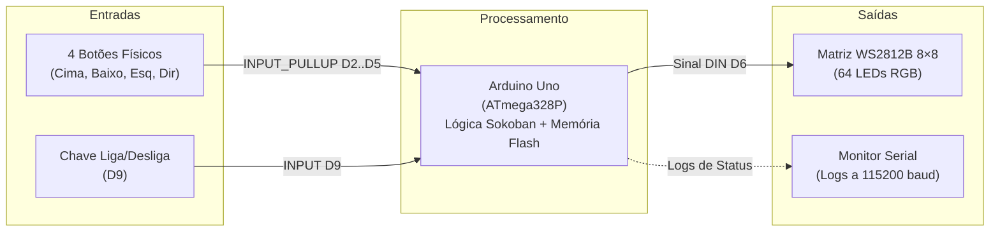
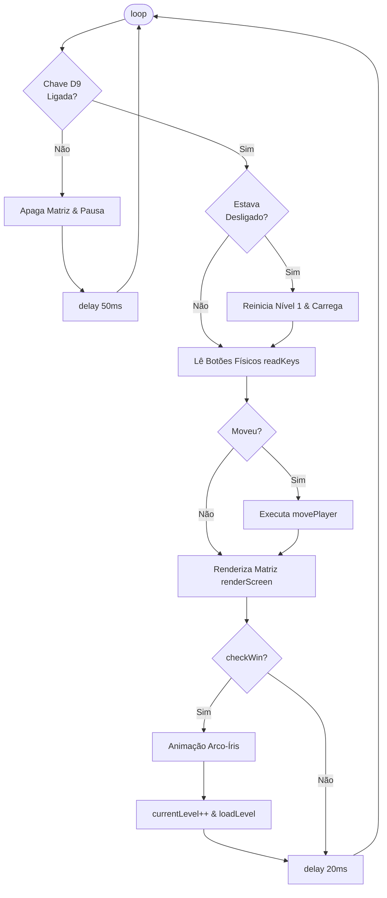

# Sokoban – Firmware Arduino Uno (Modo Standalone / Autônomo)

Firmware autônomo do jogo clássico **Sokoban** implementado em um **Arduino Uno** conectado a uma **matriz de LEDs endereçáveis WS2812B 8×8 (NeoPixel)**, com controle através de 4 botões direcionais e uma chave geral de energia/pausa.

Arquivo fonte: [`uno-controller.ino`](uno-controller.ino)

---

## 1. Visão Geral

Esta versão do firmware foi projetada para operar de forma **100% autônoma (offline)**, sem necessidade de computador conectado ou sincronização serial contínua. Toda a lógica de regras, movimentação, empurrão de caixas, detecção de vitória e transição de fases roda localmente no microcontrolador ATmega328P.

A porta Serial (115200 baud) é utilizada apenas para envio de mensagens informativas de diagnóstico (status de inicialização e chave liga/desliga).



---

## 2. Hardware e Pinagem

### 2.1. Tabela de Conexões

| Elemento | Pino Arduino | Modo do Pino | Lógica / Comportamento |
|---|---|---|---|
| **Botão DIREITA** | `D2` | `INPUT_PULLUP` | Pressionado = `LOW` (GND) |
| **Botão ESQUERDA** | `D3` | `INPUT_PULLUP` | Pressionado = `LOW` (GND) |
| **Botão BAIXO** | `D4` | `INPUT_PULLUP` | Pressionado = `LOW` (GND) |
| **Botão CIMA** | `D5` | `INPUT_PULLUP` | Pressionado = `LOW` (GND) |
| **Matriz NeoPixel (DIN)** | `D6` | `OUTPUT` | Sinal de dados de 800 kHz para os 64 LEDs |
| **Chave Liga/Desliga** | `D9` | `INPUT` | `HIGH` = Jogo Ativo / `LOW` = Pausado e Apagado |

### 2.2. Componentes Necessários
- **Microcontrolador:** Arduino Uno R3 (ATmega328P, 16 MHz, 2 KB SRAM, 32 KB Flash).
- **Display:** Matriz de LED WS2812B 8×8 (64 pixels RGB).
- **Controles:** 4 botões tácteis (push-buttons) conectados entre os pinos digitais e o GND (usa resistores internos de pull-up).
- **Chave:** 1 chave gangorra ou toggle switch conectada ao pino D9.
- **Alimentação:** 5V DC externa recomendada para a matriz de LEDs (comum com o GND do Arduino) ou alimentação via cabo USB (limitando o brilho para evitar sobrecorrente).

> [!TIP]
> O brilho padrão está configurado em **25** (`BRIGHTNESS = 25`, aprox. 10% do brilho total de 255). Esse valor garante visualização nítida das cores e mantém o consumo de corrente baixo (menos de 300 mA para toda a matriz), permitindo testes seguros via USB.

---

## 3. Entradas e Controles

### 3.1. Botões Direcionais (D2 a D5)
A leitura dos botões é feita pela função `readKeys()`, com lógica de espera por desacionamento (*debounce* bloqueante):

```cpp
if (digitalRead(PIN_UP) == LOW) {
  while (digitalRead(PIN_UP) == LOW) delay(10);
  return 'U';
}
```

- **Operação de Toque Único:** Ao pressionar um botão, o movimento é registrado e o firmware aguarda o usuário soltar o botão antes de aceitar uma nova entrada, impedindo passos indesejados em sequência rápida.
- **Prioridade de Leitura:** CIMA (`PIN_UP`) $\rightarrow$ BAIXO (`PIN_DOWN`) $\rightarrow$ ESQUERDA (`PIN_LEFT`) $\rightarrow$ DIREITA (`PIN_RIGHT`).

### 3.2. Chave Liga / Desliga (Pino D9)
- **Posição OFF (`LOW`):**
  - A matriz de LEDs é imediatamente apagada (`strip.clear()`, `strip.show()`).
  - O loop do jogo é interrompido.
  - Mensagem Serial: `Chave OFF -> Sistema pausado.`
- **Posição ON (`HIGH`):**
  - O sistema é inicializado/reiniciado.
  - A fase atual volta ao **Nível 1** (`currentLevel = 0`).
  - O tabuleiro é recarregado e a renderização é restabelecida.
  - Mensagem Serial: `Chave ON -> Jogo iniciado do zero.`

---

## 4. Representação Visual e Cores

Cada entidade clássica do Sokoban possui um caractere de representação e uma cor correspondente na matriz WS2812B:

| Entidade | Char | Cor RGB | Código Hex / RGB | Efeito / Descrição |
|---|:---:|---|---|---|
| **Parede** | `#` | Azul Escuro / Acinzentado | `(25, 38, 60)` | Limites e obstáculos intransponíveis |
| **Destino (Goal)** | `.` | Verde | `(0, 85, 0)` | Local onde as caixas devem ser colocadas |
| **Caixa (Box)** | `$` | Marrom / Âmbar | `(120, 53, 15)` | Caixa que pode ser empurrada |
| **Caixa no Destino** | `*` | Ciano | `(0, 170, 170)` | Caixa posicionada com sucesso na meta |
| **Chão / Vazio** | `' '` | Apagado (Preto) | `(0, 0, 0)` | Área livre transitável |
| **Jogador** | `@` | Vermelho Pulsante | `(80~255, 0, 0)` | Intensidade pulsante com curva senoidal |
| **Jogador no Destino** | `+` | Amarelo Pulsante | `(80~255, 80~255, 0)` | Jogador pisando sobre uma vaga de meta |

### 4.1. Pulso Senoidal do Jogador
Para destacar a posição do jogador mesmo em tabuleiros cheios, a função `renderScreen()` calcula uma oscilação senoidal contínua:

$$\text{pulse} = \frac{\cos\left(\frac{\text{pulseCounter}}{38} \cdot 2\pi\right) + 1.0}{2.0}$$

O canal vermelho oscila entre 80 e 255 (`80 + 175 * pulse`), criando um efeito orgânico de respiração visual a cada ~760 ms.

### 4.2. Mapeamento da Matriz 8×8 (`mapLED`)
Diferentes montagens físicas de matrizes de LED podem exigir ajustes de rotação ou espelhamento. A orientação atual no código é:

```cpp
uint16_t mapLED(uint8_t x, uint8_t y) {
  return (7 - x) * 8 + y;
}
```

> [!NOTE]
> Se o gabinete ou a orientação do display resultar em movimento invertido (por exemplo, pressionar "Cima" e o LED descer), ajuste a fórmula de `mapLED`:
> - **Padrão Linear Direto:** `return y * 8 + x;`
> - **Padrão Serpentina (Zig-zag):**
>   ```cpp
>   return (y % 2 == 0) ? (y * 8 + x) : (y * 8 + (7 - x));
>   ```

---

## 5. Fases Nativas na Memória Flash (`PROGMEM`)

Para não sobrecarregar os 2 KB de memória SRAM do ATmega328P, as matrizes das fases são armazenadas diretamente na memória Flash utilizando o modificador `PROGMEM` e lidas com `pgm_read_byte`.

O jogo inclui **4 níveis integrados** em grid 8×8:

### Nível 1: Introdução
Fase de aprendizado rápido com apenas 1 caixa e 1 destino em linha reta.
```text
########
#      #
#  $   #
#  .   #
#  @   #
#      #
#      #
########
```

### Nível 2: Duplo Alvo
Duas caixas e dois destinos alinhados verticalmente, exigindo manobra de contorno.
```text
########
#      #
#  .   #
#  $   #
#  $   #
#  @   #
#  .   #
########
```

### Nível 3: O Contorno
Paredes internas formam um obstáculo central exigindo planejamento de rota para contornar a estrutura.
```text
########
#  .   #
#  ##$ #
#  #   #
#  $ . #
#  #   #
#  @   #
########
```

### Nível 4: Pequeno Labirinto
Labirinto compacto com passagens estreitas e duas caixas que podem facilmente ficar presas nos cantos.
```text
########
# .$ . #
#  $   #
#  ##  #
#      #
#   @  #
#      #
########
```

---

## 6. Lógica do Jogo

### 6.1. Ciclo de Execução Principal (`loop`)



### 6.2. Regras de Movimentação (`movePlayer`)
1. **Limites do Tabuleiro:** Qualquer movimento que ultrapasse as bordas $[0..7, 0..7]$ é descartado.
2. **Paredes:** Movimento bloqueado se a casa de destino for parede (`#`).
3. **Empurrão de Caixas:**
   - Se a casa à frente tiver uma caixa (`$` ou `*`), o jogo calcula a posição posterior da caixa (`bx, by`).
   - Se a posição posterior for parede ou outra caixa, o movimento é bloqueado.
   - Se livre, a caixa é empurrada para chão (`EMPTY -> BOX`) ou para destino (`GOAL -> BOX_GOAL`).
   - A posição anterior da caixa se torna chão livre (`EMPTY`) ou meta desocupada (`GOAL`).
   - O contador de empurrões (`pPush`) é incrementado.
4. **Passo do Jogador:** O jogador assume a nova casa e libera a posição anterior, incrementando `pMove`.

### 6.3. Verificação de Vitória (`checkWin`)
O tabuleiro é inspecionado a cada quadro:
- Se houver qualquer destino vago (`GOAL` ou `PLAYER_GOAL`), o nível continua.
- Se não houver destinos vazios e a contagem de caixas em destinos (`BOX_GOAL`) for maior que zero, a vitória é confirmada.

### 6.4. Animação de Vitória (`winAnimation`)
Ao vencer uma fase:
1. O brilho da fita é reduzido para nível 8 para efeito suave.
2. É executada uma animação de arco-íris rotativo em HSV com correção gama (`strip.gamma32`) percorrendo os 64 LEDs durante ~2 segundos.
3. O brilho volta ao normal (`BRIGHTNESS = 25`).
4. O próximo nível é carregado automaticamente (`(currentLevel + 1) % TOTAL_LEVELS`).

---

## 7. Como Compilar e Usar

### 7.1. Pré-requisitos
1. **Arduino IDE** (versão 1.8.x ou 2.x) instalada.
2. Biblioteca **Adafruit NeoPixel**:
   - No Arduino IDE, acesse: *Sketch* $\rightarrow$ *Incluir Biblioteca* $\rightarrow$ *Gerenciar Bibliotecas...*
   - Procure por `Adafruit NeoPixel` e instale a versão mais recente.

### 7.2. Gravação no Arduino
1. Abra o arquivo [`uno-controller.ino`](uno-controller.ino).
2. Selecione a placa: **Ferramentas** $\rightarrow$ **Placa** $\rightarrow$ **Arduino Uno**.
3. Selecione a porta serial correspondente à placa (**COMx** no Windows ou `/dev/ttyUSBx` no Linux/macOS).
4. Clique no botão **Carregar** (ícone de seta $\rightarrow$).

### 7.3. Execução
1. Abra o **Monitor Serial** configurado para **115200 baud**.
2. Certifique-se de que a chave no pino D9 esteja no nível `HIGH` (ou conectada a 5V).
3. A mensagem `"Sokoban Uno Standalone Iniciado."` aparecerá no console e a fase 1 acenderá na matriz de LEDs.
4. Use os botões físicos para guiar o ponto vermelho pulsante e empurrar as caixas marrons até os destinos verdes!

---

## 8. Diferenças: `uno-controller` vs `uno-controller-website`

Este repositório possui duas implementações do controlador de Sokoban no Arduino Uno:

| Característica | `uno-controller` *(Este Firmware)* | `uno-controller-website` |
|---|---|---|
| **Propósito** | Modo 100% autônomo / offline | Integrado com site web via Serial bidirecional |
| **Dependência do PC** | Nenhuma (pode funcionar ligado em fonte/bateria 5V) | Sincroniza em tempo real com navegador via Web Serial API |
| **Controle por Botões** | Leitura simples com espera de liberação | Máquina de estados não bloqueante (`millis()`) |
| **Função Undo (Desfazer)** | Não disponível | Pilha circular de 80 passos com combo **CIMA+BAIXO (1 s)** |
| **Reset da Fase** | Via chave D9 (desligar e religar volta ao Nível 1) | Botão **CIMA mantido por 3 s** ou comando serial `RESET` |
| **Fases Customizadas** | Apenas as 4 fases nativas da Flash | Permite receber fases 8×8 desenhadas no site (`SET_MAP`) |
| **Consumo de SRAM** | Muito baixo (~260 bytes + buffer NeoPixel) | Moderado (~590 bytes + buffer NeoPixel + histórico undo) |
| **Complexidade** | Código enxuto (~328 linhas), fácil manutenção | Arquitetura de protocolo de comandos ASCII (~640 linhas) |

---

## 9. Diagnóstico e Resolução de Problemas

- **Matriz não acende:**
  - Verifique se a chave em D9 está recebendo sinal `HIGH` (5V). Se D9 estiver solto ou em `LOW`, o firmware mantém a fita apagada.
  - Confirme se o pino DIN da fita está no pino digital **D6** e se GND do Arduino e da fita estão conectados juntos.
- **Movimentos trocados ou tabuleiro deitado:**
  - Altere a fórmula na função `mapLED(x, y)` conforme a orientação física da sua matriz.
- **LEDs piscando em branco ou travamento durante a vitória:**
  - Queda de tensão por falta de corrente. Alimente a matriz com uma fonte externa de 5V ou certifique-se de que o cabo USB esteja conectado a uma porta USB 3.0 de boa capacidade.

