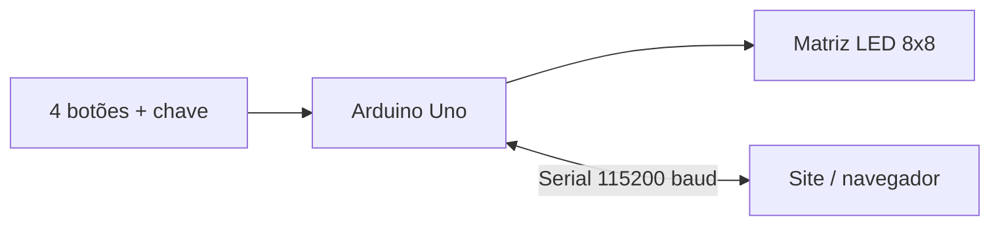

# Sokoban – Firmware Arduino Uno (controlador + site)

Firmware do jogo **Sokoban** em uma matriz de LEDs WS2812 8×8, controlado por 4 botões físicos e, opcionalmente, por um site via porta Serial.

Arquivo principal: [`uno-controller-website.ino`](uno-controller-website.ino)

---

## 1. Visão geral

O Arduino Uno guarda a lógica completa do jogo. O site (navegador) se conecta pela Serial e pode:

- **Espelhar** o jogo: cada movimento físico é enviado ao site, e cada movimento do site é executado no Uno.
- **Ler** as 4 fases nativas gravadas na Flash (para renderizar e resolver com A*).
- **Enviar** fases novas (8×8) para o Uno jogar na matriz de LEDs.



---

## 2. Hardware

| Item | Pino | Observação |
|---|---|---|
| Botão **DIREITA** | D2 | `INPUT_PULLUP` (pressionado = `LOW`) |
| Botão **ESQUERDA** | D3 | `INPUT_PULLUP` |
| Botão **BAIXO** | D4 | `INPUT_PULLUP` |
| Botão **CIMA** | D5 | `INPUT_PULLUP` |
| Matriz WS2812 8×8 (DIN) | D6 | 64 LEDs, brilho ~10% (25/255) |
| Chave liga/desliga | D9 | `INPUT`; `HIGH` = ligado, `LOW` = pausado |

- Placa: Arduino Uno (ATmega328P, 2 KB SRAM, 32 KB Flash).
- Biblioteca: `Adafruit_NeoPixel`.
- Os botões ligam o pino ao GND (sem resistor externo, usa o pull-up interno).

---

## 3. Entradas

### 3.1. Botões físicos

A leitura é **não bloqueante** (baseada em `millis()`, debounce de 35 ms).

| Ação | Resultado |
|---|---|
| Pressionar uma direção | Move o jogador e envia `MV:<U\|D\|L\|R>` na Serial |
| **CIMA + BAIXO** juntos por **1 s** | Desfaz o último movimento (undo) e envia `CMD:UNDO` |
| **CIMA** sozinho por **3 s** | Reinicia a fase e envia `CMD:RESET` |

Detalhes:
- Undo e reset disparam **uma vez**; só repetem depois de soltar o botão (no combo, ao soltar ao menos um).
- No combo CIMA+BAIXO, o primeiro botão pressionado ainda gera seu movimento; o segundo é ignorado.
- Se movimento for bloqueado (parede, caixa travada), nada é enviado.

### 3.2. Chave liga/desliga (D9)

- **OFF:** apaga a matriz e pausa o jogo (a Serial ainda responde `SYNC` e `GET_MAP`).
- **ON:** reinicia do zero, na fase nativa 1.

### 3.3. Serial (PC → Uno)

Ver [seção 5](#5-protocolo-serial).

---

## 4. Saídas

### 4.1. Matriz de LEDs

| Elemento | Símbolo | Cor |
|---|---|---|
| Parede | `#` | Azul escuro |
| Destino | `.` | Verde |
| Caixa | `$` | Marrom |
| Caixa no destino | `*` | Ciano |
| Chão | ` ` | Apagado |
| Jogador | `@` | Vermelho pulsante |
| Jogador sobre destino | `+` | Amarelo pulsante |

- Ao vencer: animação arco-íris (~2 s) e a fase seguinte é carregada (fases nativas avançam em ciclo 1→2→3→4→1; uma fase remota é reiniciada).
- Mapeamento físico em `mapLED(x, y)`. Se a imagem estiver rotacionada/invertida, ajuste essa função.

### 4.2. Serial (Uno → PC)

Mensagens `MV:`, `CMD:UNDO`, `CMD:RESET`, `WIN:`, `SYNC:`, `MAP_*`. Linhas começando com `INFO:` são só depuração e podem ser ignoradas.

---

## 5. Protocolo Serial

- **115200 baud**, texto ASCII, cada mensagem termina em `\n` (`\r` é ignorado).
- Linha máxima: 39 caracteres.
- Comandos desconhecidos são ignorados.

### 5.1. Comandos PC → Uno

| Comando | Efeito | Resposta |
|---|---|---|
| `SYNC` | Pede o estado atual | `SYNC:<origem>,<id>,<movimentos>` |
| `GET_STATE` | Lê o **tabuleiro atual** (posição do jogador e das caixas) | `STATE_START…STATE_END` |
| `GET_MAP:<1-4>` | Lê uma fase nativa | `MAP_START…MAP_END` (ou `MAP_ERR` se id inválido) |
| `SET_MAP:<id>` + 8× `MAP_ROW:<y>,<8 chars>` + `MAP_LOAD` | Carrega fase remota e começa a jogá-la | `MAP_OK` ou `MAP_ERR` |
| `SET_LEVEL:<1-4>` | Troca para uma fase nativa (reinicia a fase) | `LEVEL_OK` ou `LEVEL_ERR` |
| `SET_LEVEL:CUSTOM` | Volta para a última fase remota enviada com `SET_MAP` | `LEVEL_OK` ou `LEVEL_ERR` |
| `MV:<U\|D\|L\|R>` | Executa um movimento | nenhuma (sem eco) |
| `UNDO` | Desfaz o último movimento | nenhuma |
| `RESET` | Reinicia a fase ativa | nenhuma |

`<origem>` é `NATIVE` ou `CUSTOM`. `<id>` é 1–4 nas nativas, ou o id enviado em `SET_MAP`.

### 5.2. Mensagens Uno → PC

| Mensagem | Quando |
|---|---|
| `MV:<dir>` | Movimento feito por botão físico |
| `CMD:UNDO` | Undo pelos botões (CIMA+BAIXO 3 s) |
| `CMD:RESET` | Reset pelo botão (CIMA 5 s) |
| `WIN:<origem>,<id>` | Todas as caixas nos destinos |
| `SYNC:<origem>,<id>,<movs>` | Resposta a `SYNC`, ao ligar a chave e após vitória |
| `INFO:<texto>` | Depuração |

### 5.3. Exemplos

**Ler a fase 1:**
```text
PC  -> GET_MAP:1
UNO -> MAP_START:NATIVE,1
UNO -> MAP_ROW:0,########
UNO -> MAP_ROW:1,#      #
UNO -> MAP_ROW:2,#  $   #
UNO -> MAP_ROW:3,#  .   #
UNO -> MAP_ROW:4,#  @   #
UNO -> MAP_ROW:5,#      #
UNO -> MAP_ROW:6,#      #
UNO -> MAP_ROW:7,########
UNO -> MAP_END
```

**Ler o estado atual (jogador e caixas):**
```text
PC  -> GET_STATE
UNO -> STATE_START:NATIVE,1,2
UNO -> STATE_ROW:0,########
UNO -> STATE_ROW:1,#  $   #
UNO -> STATE_ROW:2,#  @   #
UNO -> STATE_ROW:3,#  .   #
UNO -> STATE_ROW:4,#      #
UNO -> STATE_ROW:5,#      #
UNO -> STATE_ROW:6,#      #
UNO -> STATE_ROW:7,########
UNO -> STATE_END
```
`STATE_START:<origem>,<id>,<movimentos>`. Símbolos: `@` jogador, `+` jogador sobre destino, `$` caixa, `*` caixa no destino, `.` destino vazio, `#` parede, espaço = chão. Diferente do `GET_MAP` (layout **inicial** de uma fase nativa), o `GET_STATE` reflete o jogo em andamento, inclusive em fases remotas. Funciona também com a chave desligada, mostrando o último estado.

**Trocar de fase:**
```text
PC  -> SET_LEVEL:3          (fase nativa 3)
UNO -> LEVEL_OK
PC  -> SET_LEVEL:CUSTOM     (última fase enviada por SET_MAP)
UNO -> LEVEL_OK
```
`LEVEL_ERR` se o id não estiver em 1–4, se ainda não houver fase remota guardada, se a chave estiver desligada, durante a animação de vitória ou durante um `SET_MAP`. O Uno guarda **uma** fase remota por vez; um novo `SET_MAP` válido substitui a anterior (para voltar a uma fase remota antiga, reenvie-a). Depois do `LEVEL_OK`, use `SYNC` ou `GET_STATE` para confirmar.

**Enviar uma fase do site:**
```text
PC  -> SET_MAP:5
PC  -> MAP_ROW:0,########
PC  -> ...
PC  -> MAP_ROW:7,########
PC  -> MAP_LOAD
UNO -> MAP_OK
```

Regras de validação: as 8 linhas precisam chegar, cada uma com **exatamente 8 caracteres** dos tipos `# @ . $ + *` ou espaço, e deve haver **exatamente um** jogador (`@` ou `+`). Espaços no final da linha **não podem ser removidos**.

> [!IMPORTANT]
> Durante o recebimento do mapa, a matriz para de atualizar (para não perder bytes na Serial). Se o `MAP_LOAD` não chegar em 10 s após a última linha, o Uno descarta o mapa e envia `MAP_ERR`.

**Anti-eco:** movimentos recebidos pela Serial não são reenviados, evitando loop com o site.

---

## 6. Como o firmware funciona

### 6.1. Loop principal (sem `delay()`)

1. Lê a chave de energia (D9).
2. Lê a Serial e processa comandos completos (`dispatchCommand`).
3. Se a animação de vitória estiver rodando, apenas avança a animação.
4. Atualiza os botões (debounce, undo, reset).
5. Verifica vitória (`WIN:` e inicia animação).
6. Renderiza a matriz a cada 20 ms.

### 6.2. Fases

- 4 fases nativas em `PROGMEM` (`levels[][8][9]`), que não ocupam RAM.
- `grid[8][8]`: estado atual do jogo.
- `customMap[8][8]`: fase remota ativa, usada como gabarito para undo e reset.
- `stagingMap[8][8]`: área temporária enquanto uma fase está sendo recebida.

### 6.3. Undo

Pilha circular de **80 passos**. Cada passo guarda a direção (2 bits) e se empurrou caixa (1 bit), em 1 nibble. Ao desfazer, o jogador volta, a caixa (se empurrada) é puxada de volta, e o piso (`GOAL` ou vazio) é restaurado a partir do mapa original.

### 6.4. Uso de memória

| Recurso | Uso |
|---|---|
| Flash | ~12,5 KB (38%) |
| SRAM global | ~590 bytes (29%) + ~192 bytes do buffer de LEDs |

---

## 7. Como usar

1. Instale a biblioteca **Adafruit NeoPixel** na Arduino IDE.
2. Selecione **Arduino Uno**, abra `uno-controller-website.ino` e faça o upload.
3. Abra o Monitor Serial em **115200 baud**, com fim de linha **Novo "\n"** (Newline).
4. Ligue a chave em D9; a fase 1 aparece na matriz.

### Testes rápidos pelo Monitor Serial

| Teste | Esperado |
|---|---|
| `SYNC` | `SYNC:NATIVE,1,0` |
| `GET_MAP:1` | 8 linhas iguais à fase 1 |
| `MV:R` | Jogador anda para a direita na matriz, sem resposta |
| `UNDO` | Jogador volta |
| Segurar CIMA 5 s | `CMD:RESET` |
| Segurar CIMA+BAIXO 3 s | `CMD:UNDO` |
| `SET_MAP:9` + linhas + `MAP_LOAD` | `MAP_OK` e a nova fase aparece |

